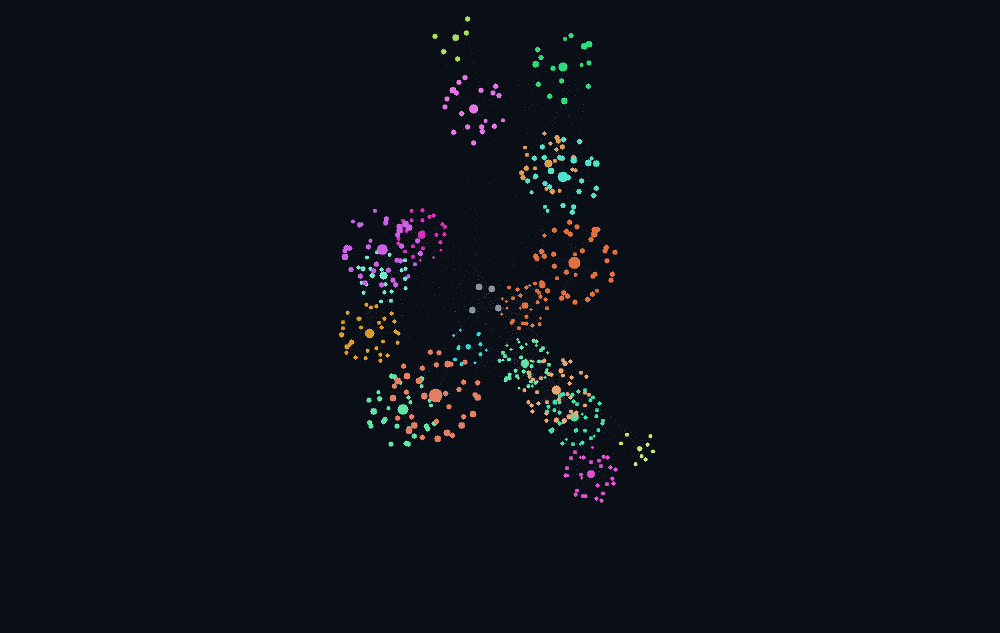

<p align="center">
  
</p>

<h1 align="center">graph3d</h1>

<p align="center">
  Visor 3D interactivo y autocontenido para grafos de código y de conocimiento: un solo HTML, sin servidor y sin librerías externas.
</p>

<p align="center">
  <a href="https://www.python.org/"></a>
  <a href="https://numpy.org/"></a>
  <a href="https://developer.mozilla.org/docs/Web/JavaScript"></a>
  <a href="https://developer.mozilla.org/docs/Web/HTML"></a>
  <a href="https://nodejs.org/"></a>
  <a href="https://github.com/features/actions"></a>
  <a href="https://git-scm.com/"></a>
  <a href="LICENSE"></a>
</p>



> La imagen es una vista previa **estática** (sin la interfaz). El visor real es interactivo: abre [`docs/demo.html`](docs/demo.html) en tu navegador.

*English:* graph3d turns a node-link JSON graph (graphify, NetworkX, D3…) into a single self-contained 3D HTML viewer. Layout is computed with NumPy; the page uses a plain 2D canvas, so it has no runtime dependencies. UI available in Spanish and English (`--lang en`).

## Qué hace

- **Un solo HTML** que funciona sin conexión: rota, haz zoom, mueve y selecciona nodos.
- **Diseño en dos niveles**: cada comunidad es una esfera (con colisión) y los nodos se acomodan dentro de ella; las comunidades se acercan según cuántas aristas las unen.
- **Color por área** (por defecto, la carpeta de primer nivel del archivo de origen) o por comunidad.
- **Filtros de selección múltiple** por área y por comunidad, búsqueda por nombre y selección de nodo con sus vecinos.
- **Rotación automática** con velocidad configurable (0.1× a 8×) y opción de girar al revés.
- **Etiquetas sin solapes** y efecto de profundidad.
- **Pantalla completa** (botón o tecla `F`) y **exportar PNG** del dibujo actual desde el propio visor.
- Interfaz en **español e inglés**.

## Requisitos

- Python 3.9+ y **un venv** (la herramienta se niega a correr fuera de uno).
- `numpy` (única dependencia, ver [`requirements.txt`](requirements.txt)).
- `node` es opcional: solo lo usan las pruebas del visor.

## Instalación

```bash
git clone <este-repo> graph3d && cd graph3d
python3 -m venv .venv
.venv/bin/pip install -r requirements.txt
```

## Uso

```bash
bin/graph3d grafo.json                         # escribe grafo-3d.html
bin/graph3d grafo.json -o salida.html --title "Mi proyecto" --lang en
.venv/bin/python -m graph3d grafo.json         # equivalente, sin el lanzador
```

`bin/graph3d` busca el venv por ti, siempre en este orden: `$GRAPH3D_VENV`, `./.venv` (el repo desde donde lo llamas) y `<este repo>/.venv`. Así puedes usarlo en cualquier proyecto que ya tenga su venv con `numpy`:

```bash
cd ~/Development/otro-repo
~/Development/graph3d/bin/graph3d graphify-out/graph.json -o graphify-out/graph-3d.html
```

### Con graphify

```bash
graphify update .
bin/graph3d graphify-out/graph.json --title "Mi repo"
```

### Opciones

| Opción | Qué hace |
| --- | --- |
| `-o, --output` | HTML de salida (por defecto `<entrada>-3d.html`) |
| `--title` | Título del visor (por defecto, el nombre del archivo) |
| `--lang es\|en` | Idioma de la interfaz |
| `--depth N` | Niveles de carpeta que definen un área (por defecto 1) |
| `--max-areas N` | Máximo de áreas; el resto va a «Otros» (por defecto 8) |
| `--areas-config FILE` | Define las áreas a mano (ver abajo) |
| `--seed N` | Semilla del diseño: misma semilla, mismo dibujo |
| `--png FILE` | Escribe además una vista previa estática en PNG |

### Áreas a mano

Sin configuración, el área de un nodo es la carpeta de primer nivel de su archivo de origen; los nodos sin archivo van a «Externo» (gris). Para controlarlo:

```json
{
  "areas": [
    { "name": "Backend",  "match": ["backend/", "api/"], "hue": 24 },
    { "name": "Frontend", "match": ["frontend/", "web/"], "hue": 205 },
    { "name": "Docs",     "match": ["docs/", "*.md"],     "hue": 285 }
  ]
}
```

`match` acepta prefijos de ruta o extensiones (`*.md`); gana la primera área que coincide. Hay un ejemplo en [`examples/areas.example.json`](examples/areas.example.json).

## Formato de entrada

JSON node-link, el que producen graphify, NetworkX (`node_link_data`) y D3:

```json
{
  "nodes": [{ "id": "a", "label": "login()", "community": 3, "source_file": "api/auth.py" }],
  "links": [{ "source": "a", "target": "b", "relation": "calls", "confidence": "EXTRACTED" }]
}
```

Solo `id` es obligatorio. Se aprovechan, si existen: `label`/`name`, `community`/`group`/`cluster`, `community_name`, `source_file`/`file`/`path`, `source_location`, `file_type` y, en las aristas, `relation` y `confidence` (las que no son `EXTRACTED` se pintan en ámbar). Las aristas pueden llamarse `links` o `edges`. Si el grafo no trae comunidades, cada área se usa como una.

## Controles

| Acción | Cómo |
| --- | --- |
| Rotar | Arrastrar |
| Mover | Shift + arrastrar, o clic derecho |
| Zoom | Rueda |
| Seleccionar | Clic en un nodo (ilumina sus vecinos; clic en un vecino salta a él) |
| Filtrar | Chips de áreas y lista de comunidades (varios a la vez) |
| Buscar | Caja de texto; Enter va al nodo más conectado que coincide |
| Pantalla completa | Botón «Pantalla completa» o tecla `F` |
| Exportar imagen | Botón «Exportar PNG»: guarda la vista actual (sin el panel lateral) con fondo oscuro |

## Cómo funciona

1. `loader` lee el grafo y reparte los nodos en áreas.
2. `layout` calcula las posiciones: un diseño de fuerzas entre comunidades (cada área parte de su propia región) y otro dentro de cada comunidad. Las comunidades aisladas se acercan al núcleo para que no encojan la vista.
3. `render` incrusta datos y posiciones en `template.html`. El HTML resultante no carga nada de la red.
4. El visor proyecta en perspectiva sobre un `canvas` 2D y encuadra la vista con una bisección sobre los puntos realmente visibles.

## Límites

- Probado con un grafo sintético de ~500 nodos y con un grafo real de ~3000 nodos y ~7000 aristas.
- El cálculo del diseño es cuadrático dentro de cada comunidad: una sola comunidad de decenas de miles de nodos será lenta.
- El dibujo es `canvas` 2D (sin WebGL): con muchos miles de nodos y aristas visibles la rotación puede perder fluidez.
- Las pruebas del visor usan un DOM simulado en `node`; no hay pruebas automáticas en un navegador real.

## Desarrollo

```bash
make test        # unittest + pruebas del visor con node (usa .venv, o VENV=/ruta/al/venv)
make demo        # regenera el ejemplo, docs/demo.html y docs/preview.png
```

Ver [CONTRIBUTING.md](CONTRIBUTING.md) y [CHANGELOG.md](CHANGELOG.md).

## Licencia

[MIT](LICENSE)
